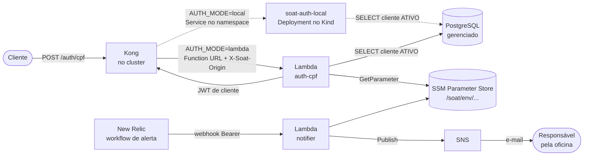

# soat-auth-lambda

Funções serverless da oficina, parte da Fase 3 do Tech Challenge 13SOAT:

- **`auth-cpf`**: o cliente informa o CPF e recebe um JWT para consumir as rotas protegidas da API.
  A função valida o CPF, confere se o cliente existe e está ativo na base, e assina o token.
- **`notifier`**: recebe os alertas do New Relic e os entrega por e-mail, via SNS.

Os outros repositórios do projeto:

| Repositório                                                                                | Papel                                                          |
| ------------------------------------------------------------------------------------------ | -------------------------------------------------------------- |
| [fiap-software-architecture](https://github.com/gomes-leonardo/fiap-software-architecture) | Aplicação principal (NestJS) no Kubernetes                     |
| [soat-infra-k8s](https://github.com/gomes-leonardo/soat-infra-k8s)                         | Cluster Kubernetes, gateway Kong e observabilidade (Terraform) |
| [soat-infra-db](https://github.com/gomes-leonardo/soat-infra-db)                           | Banco gerenciado PostgreSQL (Terraform)                        |

## Arquitetura



A linha cheia é o modo alvo, com a Lambda na AWS. A tracejada é o substituto local: o mesmo código
de autenticação rodando como Deployment no cluster Kind, usado enquanto a conta AWS não está
ativa. A variável de repositório `AUTH_MODE` escolhe o modo: com `lambda`, o pipeline remove o
substituto local, e o Kong passa a chamar a Function URL.

## Contrato da autenticação por CPF

```http
POST /                     (o Kong expõe como POST /auth/cpf)
Content-Type: application/json

{ "cpf": "529.982.247-25" }
```

| Situação                                                 | Resposta                                                                    |
| -------------------------------------------------------- | --------------------------------------------------------------------------- |
| CPF de cliente ativo                                     | `200 {"access_token": "<jwt>", "token_type": "Bearer", "expires_in": 3600}` |
| CPF inválido (dígito verificador, formato)               | `400 {"error": "invalid_cpf"}`                                              |
| CPF válido, mas cliente inexistente, inativo ou excluído | `401 {"error": "unauthorized"}`, a mesma resposta nos três casos            |
| Chamada sem o header de origem do Kong                   | `403 {"error": "forbidden"}`                                                |

O token é HS256, com `sub` = id do cliente, `role` = `client`, `iss` = `soat-auth-lambda` e validade de
1 hora. O segredo é o mesmo que a aplicação e o Kong usam, gerado pelo Terraform do `soat-infra-k8s`
e lido aqui do SSM (`/soat/<env>/jwt/secret`). A URL do banco também vem do SSM
(`/soat/<env>/db/url`), escrita pelo `soat-infra-db`. Nenhum segredo fica em variável de ambiente
das funções. Os dois segredos que este repositório gera (o do notifier e o de origem) ficam no
state do Terraform, que é criptografado no S3.

A Function URL é pública, mas só o Kong consegue usá-la: ele injeta o header `X-Soat-Origin` com
um segredo que mora em `/soat/<env>/auth/origin-secret`, e a função responde `403` a qualquer
chamada sem ele. Assim, ninguém contorna o rate limit do gateway chamando a URL direto.

A consulta à base é uma só:

```sql
SELECT id FROM clients WHERE cpf_cnpj = $1 AND status = 'ATIVO' AND deleted_at IS NULL
```

## Contrato do notifier

```http
POST /                     (Function URL do notifier, chamada pelo workflow do New Relic)
Authorization: Bearer <segredo em /soat/<env>/notifier/webhook-secret>
Content-Type: application/json

{ "issueId": "...", "title": "...", "state": "ACTIVATED", "priority": "CRITICAL" }
```

| Situação                       | Resposta                                               |
| ------------------------------ | ------------------------------------------------------ |
| Segredo correto e corpo válido | `202 {"status": "published"}`, e o e-mail sai pelo SNS |
| Sem Bearer ou segredo errado   | `401 {"error": "unauthorized"}`, e nada é publicado    |
| Corpo que não é JSON           | `400 {"error": "invalid_payload"}`                     |

A URL da função fica em `/soat/<env>/notifier/url`, de onde o `soat-infra-k8s/newrelic` a lê para
configurar o destino do alerta. O assunto do e-mail segue o formato
`[SOAT][<env>][<estado>] <título do alerta>`.

## Tecnologias

TypeScript, Node.js 22, AWS Lambda (Function URL) em `sa-east-1`, SNS, SSM Parameter Store, CloudWatch Logs,
Terraform, Jest com Testcontainers, GitHub Actions com OIDC.

**Custo:** tudo dentro do _Always Free_ da AWS (Lambda 1M requisições/mês, SNS 1.000 e-mails/mês,
CloudWatch Logs 5 GB). Não há concorrência reservada: a conta tem limite de 10 execuções simultâneas,
e a AWS exige que todas fiquem livres. A contenção de abuso fica no segredo de origem (só o Kong,
com rate limit, chama a autenticação) e no segredo Bearer do notifier. Risco residual aceito: as
duas funções disputam as mesmas 10 vagas de concorrência.

## Execução local

```bash
npm ci
npm test                  # unitários
npm run test:integration  # Postgres real via Testcontainers (precisa de Docker)
npm run build             # bundles em dist/
```

O servidor local (`local/local-server.ts`) roda o mesmo código de autenticação como um servidor
HTTP. Ele substitui a Function URL dentro do cluster Kind enquanto a AWS não está ativa. Três
diferenças em relação à Lambda: não confere o header de origem (o Service só é alcançável de dentro
do cluster), expõe `GET /health` para as probes e responde `405` a qualquer outro método. Lê
`DB_PORT` (padrão 5432) e `DB_SSL=true` além das variáveis abaixo.

```bash
docker build -t soat-auth-local .
docker run -p 8080:8080 -e DB_HOST=... -e DB_NAME=... -e DB_USER=... -e DB_PASS=... -e JWT_SECRET=... soat-auth-local
curl -X POST localhost:8080 -d '{"cpf":"529.982.247-25"}'
```

## Deploy

O pipeline (`.github/workflows/ci-cd.yml`) faz:

| Evento                                | O que roda                                                                                                                  |
| ------------------------------------- | --------------------------------------------------------------------------------------------------------------------------- |
| Pull request para `develop` ou `main` | typecheck, `format:check`, testes unitários e de integração, build, `terraform fmt` e `validate` de `infra/` e `bootstrap/` |
| Push em `develop`                     | tudo acima + `terraform apply` no ambiente **hml** + imagem local no namespace `soat-hml`                                   |
| Push em `main`                        | o mesmo, no ambiente **prd** e no namespace `soat-prd`                                                                      |
| Disparo manual (`workflow_dispatch`)  | `acao=apply` recria as funções; `acao=destroy` remove tudo da AWS, no ambiente da branch escolhida                          |

Os jobs, como aparecem no Actions: `Test`, `Terraform`, `Deploy Lambda (hml|prd)`,
`Publish auth-local image`, `Deploy auth-local no Kind (hml|prd)` e, no disparo manual,
`Destroy Lambda (hml|prd)`. Os dois de deploy no Kind rodam
no runner self-hosted com as labels `[self-hosted, soat-kind]`, o mesmo dos outros repositórios.

O acesso à AWS é por OIDC: o job de deploy assume o papel `gha-soat-deployer`. A confiança é por
GitHub Environment (`hml` ou `prd`), e cada Environment só aceita a sua branch, então pull request
nunca chega à AWS. O papel só cria papéis de função com o permissions boundary
`soat-function-boundary`, que limita qualquer função a logs, leitura de `/soat/*` e publicação em
tópicos `soat-*`.

### Uma vez, antes do primeiro deploy

1. Com uma credencial de administrador local, criar o bucket dos states (versionado e sem acesso
   público) e aplicar o bootstrap:
   ```bash
   aws s3api create-bucket --bucket soat-tfstate-310626828604 --region sa-east-1 \
     --create-bucket-configuration LocationConstraint=sa-east-1
   aws s3api put-bucket-versioning --bucket soat-tfstate-310626828604 \
     --versioning-configuration Status=Enabled
   aws s3api put-public-access-block --bucket soat-tfstate-310626828604 \
     --public-access-block-configuration \
     BlockPublicAcls=true,IgnorePublicAcls=true,BlockPublicPolicy=true,RestrictPublicBuckets=true
   terraform -chdir=bootstrap init
   terraform -chdir=bootstrap apply -var alert_email=voce@exemplo.com
   ```
   O `bootstrap/` guarda o state localmente, de propósito: ele cria o papel que o CI usa, então não
   pode depender do CI. Guarde o `terraform.tfstate` gerado.
2. Criar os Environments, cada um preso à sua branch:
   ```bash
   for pair in hml:develop prd:main; do
     env=${pair%%:*}; branch=${pair##*:}
     gh api -X PUT "repos/{owner}/{repo}/environments/$env" \
       -F 'deployment_branch_policy[protected_branches]=false' \
       -F 'deployment_branch_policy[custom_branch_policies]=true'
     gh api -X POST "repos/{owner}/{repo}/environments/$env/deployment-branch-policies" -f name="$branch"
   done
   ```
3. Cadastrar as variáveis do repositório com o `role_arn` que o passo 1 imprimiu:
   ```bash
   gh variable set AWS_ROLE_ARN --body "<role_arn>"
   gh variable set ALERT_EMAIL --body "voce@exemplo.com"
   gh variable set AUTH_MODE --body "lambda"   # opcional: sem ela, o Kong usa o substituto local
   ```
   Os jobs de deploy no Kind precisam do runner self-hosted `soat-kind` registrado no Mac do
   cluster.
4. Depois do primeiro deploy de cada ambiente, confirmar a assinatura SNS pelo link que chega no
   e-mail. É o único passo manual: sem ele, o SNS não entrega.

### Custo

O uso normal fica no nível gratuito permanente da AWS (Lambda, SNS, SSM, logs com 7 dias de
retenção). O único gasto possível é abuso das Function URLs públicas, e três travas o limitam:

- **Disjuntor** (`bootstrap/cost-guard.tf`): um orçamento mensal de US$ 1, medido sem descontar
  créditos promocionais e só sobre os serviços do projeto (Lambda, SNS, CloudWatch, EventBridge), avisa por e-mail no primeiro centavo e, ao estourar, aciona a função
  `cost-guard`, que zera a concorrência de toda função `soat-*`. A AWS passa a recusar as chamadas
  sem executá-las, e chamada recusada não é cobrada. O Budgets atualiza algumas vezes por dia, então
  ele age com horas de atraso; sob abuso, o próprio `cost-guard` disputa as 10 execuções simultâneas
  da conta e pode demorar mais. A mesma função roda a cada 6 horas e reaplica o bloqueio enquanto o
  gasto do mês estiver no limite, então religar ou recriar as funções não as deixa desprotegidas. O
  Terraform ignora a concorrência das funções, e religar é decisão de uma pessoa (no mês seguinte,
  ou depois de entender o gasto):
  ```bash
  aws lambda delete-function-concurrency --function-name soat-hml-auth-cpf --region sa-east-1
  ```
  Para testar a cadeia depois do bootstrap: `aws sns publish --topic-arn <arn do cost-guard>
--message teste --region sa-east-1` bloqueia as funções; o comando acima as religa. E
  `aws budgets describe-budget --account-id <conta> --budget-name soat-cost-guard` deve mostrar
  `IncludeCredit: false`.
- **Vida curta**: as funções só precisam existir para a demonstração e a avaliação. Fora disso,
  rodar o workflow com `acao=destroy`; `acao=apply` recria. Antes do destroy, tirar `AUTH_MODE` de
  `lambda`, para o Kong voltar ao substituto local, e lembrar que o Terraform do New Relic
  (`soat-infra-k8s/newrelic`) lê a URL do notifier do SSM: ele só aplica com as funções no ar.
- **Escopo do papel de deploy**: o `gha-soat-deployer` não tem permissão sobre EC2, RDS, EKS nem
  rede, então o pipeline não cria nada fora das funções, do tópico e dos parâmetros.

### Deploy manual

```bash
npm run build
terraform -chdir=infra init \
  -backend-config="bucket=soat-tfstate-310626828604" \
  -backend-config="key=soat-auth-lambda/infra/hml/terraform.tfstate"
terraform -chdir=infra apply -var environment=hml -var alert_email=voce@exemplo.com
```

## Links

- Swagger da API principal: [docs/swagger.json](https://github.com/gomes-leonardo/fiap-software-architecture/blob/main/docs/swagger.json)
- Postman: [docs/postman-collection.json](https://github.com/gomes-leonardo/fiap-software-architecture/blob/main/docs/postman-collection.json)
- Deploys ativos: a URL de cada função aparece no resumo do último run de `develop` (hml) e de
  `main` (prd), nas [execuções do Actions](https://github.com/gomes-leonardo/soat-auth-lambda/actions).
  O ponto de entrada do cliente é o Kong de cada ambiente, em `http://127.0.0.1:18081/auth/cpf`
  (hml) e `http://127.0.0.1:18080/auth/cpf` (prd), no cluster Kind do projeto.
