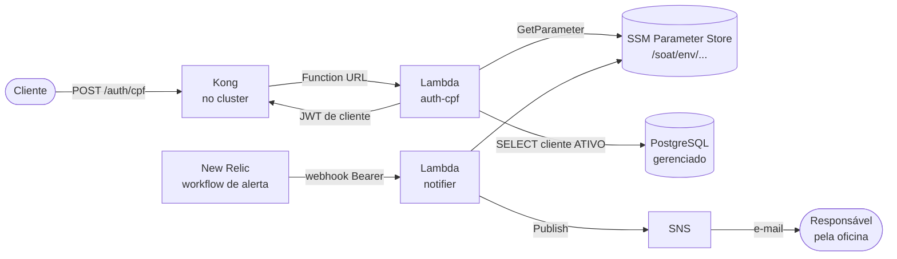

# soat-auth-lambda

Funções serverless da oficina, parte da Fase 3 do Tech Challenge 13SOAT:

- **`auth-cpf`**: o cliente informa o CPF e recebe um JWT para consumir as rotas protegidas da API.
  A função valida o CPF, confere se o cliente existe e está ativo na base, e assina o token.
- **`notifier`**: recebe os alertas do New Relic e os entrega por e-mail, via SNS.

Os outros repositórios do projeto:

| Repositório                                                                                | Papel                                                          |
| ------------------------------------------------------------------------------------------ | -------------------------------------------------------------- |
| [fiap-software-architecture](https://github.com/gomes-leonardo/fiap-software-architecture) | Aplicação principal (NestJS) no Kubernetes                     |
| [soat-infra-k8s](https://github.com/gomes-leonardo/soat-infra-k8s)                         | Cluster Kubernetes, gateway Kong e observabilidade (Terraform) |
| [soat-infra-db](https://github.com/gomes-leonardo/soat-infra-db)                           | Banco gerenciado PostgreSQL (Terraform)                        |

## Arquitetura



## Contrato da autenticação por CPF

```http
POST /                     (o Kong expõe como POST /auth/cpf)
Content-Type: application/json

{ "cpf": "529.982.247-25" }
```

| Situação                                                 | Resposta                                                                    |
| -------------------------------------------------------- | --------------------------------------------------------------------------- |
| CPF de cliente ativo                                     | `200 {"access_token": "<jwt>", "token_type": "Bearer", "expires_in": 3600}` |
| CPF inválido (dígito verificador, formato)               | `400 {"error": "invalid_cpf"}`                                              |
| CPF válido, mas cliente inexistente, inativo ou excluído | `401 {"error": "unauthorized"}`, a mesma resposta nos três casos            |

O token é HS256, com `sub` = id do cliente, `role` = `client`, `iss` = `soat-auth-lambda` e validade de
1 hora. O segredo é o mesmo que a aplicação e o Kong usam, gerado pelo Terraform do `soat-infra-k8s`
e lido aqui do SSM (`/soat/<env>/jwt/secret`). A URL do banco também vem do SSM
(`/soat/<env>/db/url`), escrita pelo `soat-infra-db`. Nenhum segredo fica em variável de ambiente
das funções. Os dois segredos que este repositório gera (o do notifier e o de origem) ficam no
state do Terraform, que é criptografado no S3.

A Function URL é pública, mas só o Kong consegue usá-la: ele injeta o header `X-Soat-Origin` com
um segredo que mora em `/soat/<env>/auth/origin-secret`, e a função responde `403` a qualquer
chamada sem ele. Assim, ninguém contorna o rate limit do gateway chamando a URL direto.

A consulta à base é uma só:

```sql
SELECT id FROM clients WHERE cpf_cnpj = $1 AND status = 'ATIVO' AND deleted_at IS NULL
```

## Tecnologias

TypeScript, Node.js 22, AWS Lambda (Function URL), SNS, SSM Parameter Store, CloudWatch Logs,
Terraform, Jest com Testcontainers, GitHub Actions com OIDC.

**Custo:** tudo dentro do _Always Free_ da AWS (Lambda 1M requisições/mês, SNS 1.000 e-mails/mês,
CloudWatch Logs 5 GB). Não há concorrência reservada: a conta tem limite de 10 execuções simultâneas,
e a AWS exige que todas fiquem livres. A contenção de abuso fica no segredo de origem (só o Kong,
com rate limit, chama a autenticação) e no segredo Bearer do notifier. Risco residual aceito: as
duas funções disputam as mesmas 10 vagas de concorrência.

## Execução local

```bash
npm ci
npm test                  # unitários
npm run test:integration  # Postgres real via Testcontainers (precisa de Docker)
npm run build             # bundles em dist/
```

O servidor local (`local/local-server.ts`) roda o mesmo código de autenticação como um servidor
HTTP. Ele substitui a Function URL dentro do cluster Kind enquanto a AWS não está ativa:

```bash
docker build -t soat-auth-local .
docker run -p 8080:8080 -e DB_HOST=... -e DB_NAME=... -e DB_USER=... -e DB_PASS=... -e JWT_SECRET=... soat-auth-local
curl -X POST localhost:8080 -d '{"cpf":"529.982.247-25"}'
```

## Deploy

O pipeline (`.github/workflows/ci-cd.yml`) faz:

| Evento                                | O que roda                                                                                |
| ------------------------------------- | ----------------------------------------------------------------------------------------- |
| Pull request para `develop` ou `main` | testes, build, `terraform fmt` e `validate`                                               |
| Push em `develop`                     | tudo acima + `terraform apply` no ambiente **hml** + imagem local no namespace `soat-hml` |
| Push em `main`                        | o mesmo, no ambiente **prd** e no namespace `soat-prd`                                    |

O acesso à AWS é por OIDC: o job de deploy assume o papel `gha-soat-deployer`. A confiança é por
GitHub Environment (`hml` ou `prd`), e cada Environment só aceita a sua branch, então pull request
nunca chega à AWS. O papel só cria papéis de função com o permissions boundary
`soat-function-boundary`, que limita qualquer função a logs, leitura de `/soat/*` e publicação em
tópicos `soat-*`.

### Uma vez, antes do primeiro deploy

1. Com uma credencial de administrador local:
   ```bash
   terraform -chdir=bootstrap init && terraform -chdir=bootstrap apply
   ```
2. Criar os Environments, cada um preso à sua branch:
   ```bash
   for pair in hml:develop prd:main; do
     env=${pair%%:*}; branch=${pair##*:}
     gh api -X PUT "repos/{owner}/{repo}/environments/$env" \
       -F 'deployment_branch_policy[protected_branches]=false' \
       -F 'deployment_branch_policy[custom_branch_policies]=true'
     gh api -X POST "repos/{owner}/{repo}/environments/$env/deployment-branch-policies" -f name="$branch"
   done
   ```
3. Cadastrar as variáveis do repositório com o `role_arn` que o passo 1 imprimiu:
   ```bash
   gh variable set AWS_ROLE_ARN --body "<role_arn>"
   gh variable set ALERT_EMAIL --body "voce@exemplo.com"
   ```
4. Depois do primeiro deploy de cada ambiente, confirmar a assinatura SNS pelo link que chega no
   e-mail. É o único passo manual: sem ele, o SNS não entrega.

### Deploy manual

```bash
npm run build
terraform -chdir=infra init \
  -backend-config="bucket=tfstate-backend-fiap-leo" \
  -backend-config="key=soat-auth-lambda/infra/hml/terraform.tfstate"
terraform -chdir=infra apply -var environment=hml -var alert_email=voce@exemplo.com
```

## Links

- Swagger da API principal: [docs/swagger.json](https://github.com/gomes-leonardo/fiap-software-architecture/blob/main/docs/swagger.json)
- Postman: [docs/postman-collection.json](https://github.com/gomes-leonardo/fiap-software-architecture/blob/main/docs/postman-collection.json)
- Deploys ativos: a URL de cada função aparece no resumo do último run de `develop` (hml) e de
  `main` (prd), em _Actions_.
